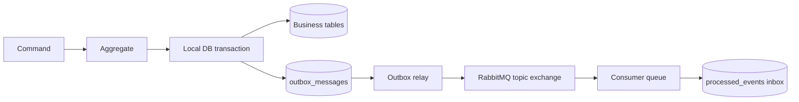

# Transactional Outbox, Clean Architecture và DDD

Tài liệu này vừa là design document vừa là tài liệu học tập cho boilerplate NestJS.
Mục tiêu là giải thích vì sao kiến trúc được tổ chức như hiện tại, sau đó chỉ ra cách
triển khai Transactional Outbox với PostgreSQL và RabbitMQ. Dự án dùng CQRS ở mức
application layer, nhưng không xem `EventBus` của CQRS là message broker.

## 1. Bối cảnh: bài toán dual-write

Một command thường phải thay đổi database và phát một event:

```text
UPDATE database + PUBLISH RabbitMQ
```

Nếu publish trực tiếp sau khi ghi database, hai thao tác không atomic:

| Tình huống | Hậu quả |
|---|---|
| Database commit, app chết trước publish | Event bị mất |
| Publish thành công, database rollback | Consumer nhận event ma |
| Broker tạm unavailable | Request nghiệp vụ bị phụ thuộc vào broker |

Transactional Outbox giải quyết bằng cách ghi business data và event vào cùng một
transaction database. Một relay riêng đọc event đã commit rồi publish ra broker.



Outbox không tạo exactly-once delivery. Semantics của hệ thống là **at-least-once**:
relay có thể publish lại nếu broker đã ACK nhưng process chết trước khi cập nhật row
thành `PUBLISHED`. Vì vậy consumer phải idempotent bằng `messageId` và inbox/dedup.

## 2. Clean Architecture trong boilerplate

Dependency rule:

```text
Presentation → Application → Domain
       ↓             ↓
Infrastructure ─────┘
```

- **Domain**: luật nghiệp vụ, aggregate, value object, domain event và repository port.
- **Application**: command/query handlers, transaction boundary, integration-event
  contract và orchestration như outbox relay.
- **Infrastructure**: TypeORM, PostgreSQL, RabbitMQ, scheduler và repository adapters.
- **Presentation**: HTTP controllers, request/response DTO và broker subscriber entrypoint.

Domain không import NestJS, TypeORM hoặc RabbitMQ. Infrastructure implement các port
được application/domain định nghĩa và được nối bằng Symbol DI token.

### 2.1 Cấu trúc module

```text
src/
├── shared/
│   ├── application/
│   │   ├── messaging/       # integration event, OutboxConfig
│   │   └── ports/           # Unit of Work port, publisher port
│   ├── domain/
│   │   ├── base/            # BaseEntity, AggregateRoot, DomainEvent
│   │   └── repositories/    # BaseRepository, TransactionContext (opaque marker cho repository port)
│   └── infrastructure/
│       ├── messaging/rabbitmq/  # RabbitMQ adapters
│       └── database/            # database and transaction adapters
└── modules/
    ├── sample/
    │   ├── domain/
    │   ├── application/
    │   ├── infrastructure/
    │   └── presentation/    # http/ + messaging/ (subscriber)
    ├── outbox/              # phía producer: outbox + relay
    │   ├── domain/
    │   ├── application/outbox-relay/
    │   └── infrastructure/
    └── inbox/               # phía consumer: dedup theo messageId
        ├── application/ports/   # InboxRepository port
        └── infrastructure/
```

Quy ước chung về tầng và đặt tên: [`architecture.md`](architecture.md).

`inbox` không có `domain/`: nó không có trạng thái hay luật nghiệp vụ, chỉ là một
thao tác atomic `INSERT ... ON CONFLICT DO NOTHING`. Mô hình hoá thành entity sẽ dẫn tới
kiểu "đọc → kiểm tra → ghi", vốn có race condition khi hai consumer nhận cùng message.

## 3. DDD concepts dùng trong code

### Entity và Aggregate Root

Entity có identity và lifecycle. Aggregate Root là entrypoint duy nhất để thay đổi
trạng thái của một aggregate và phát domain event.

`BaseEntity` chỉ giữ identity, timestamps và soft-delete state. `AggregateRoot` giữ
collection domain events:

```ts
export abstract class AggregateRoot extends BaseEntity {
  private readonly domainEvents: DomainEvent[] = [];

  protected addDomainEvent(event: DomainEvent): void {
    this.domainEvents.push(event);
  }

  pullDomainEvents(): DomainEvent[] {
    const events = [...this.domainEvents];
    this.domainEvents.length = 0;
    return events;
  }
}
```

Entity được đọc từ database dùng `reconstitute()`, không dùng factory tạo mới, để
không phát lại event cũ.

### Domain Event và Integration Event

- **Domain Event** mô tả điều đã xảy ra trong domain, ví dụ `SampleCreatedEvent`.
- **Integration Event** là message contract gửi qua boundary của service. Nó có
  `id`, `eventType`, `routingKey`, aggregate metadata và payload.

Domain event được tạo trong aggregate. Application chuyển nó thành outbox message;
relay (application) map outbox message thành integration event, infrastructure
serialize và gửi RabbitMQ. `OutboxMessage` không import contract của application.

### CQRS EventBus và message broker

Trong dự án này cần phân biệt bốn loại message:

| Loại | Phạm vi | Vai trò |
|---|---|---|
| Command | Trong application | Yêu cầu hệ thống thực hiện một hành động |
| Domain event | Trong domain/application | Mô tả điều đã xảy ra trong aggregate |
| CQRS `EventBus` event | Trong cùng process | Gọi các event handler nội bộ, nếu cần |
| Integration event | Qua process/service boundary | Gửi qua RabbitMQ bằng outbox relay |

`@nestjs/cqrs` `EventBus` là in-process pub/sub. Nó không có durable storage,
không bảo đảm atomic với transaction database và không thay thế được RabbitMQ.
Vì vậy không publish trực tiếp một event CQRS lên broker từ command handler hoặc
event handler. Nếu process chết sau khi database commit nhưng trước khi publish,
message có thể bị mất.

Write path hiện tại giữ domain event trong aggregate, sau đó command handler gọi
`pullDomainEvents()` và ghi các event đó vào `outbox_messages` trong cùng transaction.
Relay mới chuyển chúng thành integration event và publish RabbitMQ. Đây là ranh giới
giữa domain event và message contract bên ngoài.

`EventBus` chỉ phù hợp cho side effect nội bộ không cần đi qua broker, ví dụ cập nhật
cache hoặc ghi audit trong cùng process. Nếu side effect phải được retry, durable hoặc
gửi sang service khác, dùng outbox và integration event. Việc ghi outbox không nên
được ẩn trong một event handler chạy ngoài transaction hiện tại.

## 4. Transaction boundary explicit

Boilerplate dùng explicit transaction context, không dùng `AsyncLocalStorage`.
Application chỉ biết abstraction:

```ts
export interface IUnitOfWork {
  run<T>(work: (context: TransactionContext) => Promise<T>): Promise<T>;
}
```

TypeORM adapter bọc `EntityManager` trong `TypeOrmTransactionContext`. Repository
adapter nhận context và lấy repository tương ứng từ manager đó. Domain/application
không import `EntityManager`.

Write path mẫu:

```ts
return this.unitOfWork.run(async (context) => {
  const sample = SampleEntity.create(command);
  await sampleRepository.save(sample, context);

  const messages = sample
    .pullDomainEvents()
    .map((event) => OutboxMessage.fromDomainEvent(event));

  await outboxRepository.append(messages, context);
  return sample;
});
```

Nếu bất kỳ thao tác nào throw exception, aggregate và outbox cùng rollback.

## 5. Outbox relay

Bảng `outbox_messages` lưu event đã commit nhưng chưa publish:

```text
PENDING → PROCESSING → PUBLISHED
              ↓
           PENDING → ... → FAILED
```

Relay thực hiện:

1. Reclaim row `PROCESSING` bị stale (vài lần mỗi `OUTBOX_CLAIM_TIMEOUT_MS`).
2. Claim row `PENDING` bằng `FOR UPDATE SKIP LOCKED`, theo thứ tự cột `sequence`
   (`BIGSERIAL`, không phụ thuộc `created_at` vốn có thể trùng millisecond).
3. Không claim event mới hơn nếu cùng aggregate còn event cũ `PENDING`,
   `PROCESSING` hoặc `FAILED`. Vì vậy mỗi batch có tối đa một event mỗi aggregate.
4. Publish song song cả batch bằng publisher confirm; timeout được truyền xuống
   channel để message hết hạn bị bỏ khỏi buffer, không bị flush lại khi reconnect.
5. Chỉ khi confirm thành công và message không bị broker trả về (unroutable) mới đổi
   row thành `PUBLISHED`.
6. Khi lỗi, tăng retry count và đặt `available_at` theo exponential backoff.
7. Xoá row `PUBLISHED` quá retention period (tối đa mỗi giờ một lần).

Luật chuyển trạng thái nằm trong entity `OutboxMessage` (`markPublished`,
`markFailedAttempt`); backoff và giới hạn retry nằm trong value object `RetryPolicy`.
Repository chỉ lưu kết quả qua `saveClaimOutcome`, và chỉ cập nhật row khi nó vẫn
`PROCESSING` với đúng `claimed_at` của lần claim đó, nên relay đã mất claim không ghi
đè trạng thái của relay khác.

Relay không hứa global ordering. V1 giữ ordering theo `aggregate_id`; nhiều aggregate
có thể xử lý độc lập. Row `FAILED` chặn các event sau của cùng aggregate (relay ghi
log `error` kèm lệnh gỡ). Sau khi sửa nguyên nhân, đưa nó về `PENDING` với lượt thử mới:

```bash
npm run outbox:requeue -- <message-id>          # local
npm run outbox:requeue:prod -- <message-id>     # trong container, chạy từ dist
```

`OUTBOX_MAX_ATTEMPTS` là tổng số lần publish, tính cả lần đầu (`1` = không retry).

## 6. RabbitMQ topology

```text
pbl6.events (durable topic exchange)
   ├── sample.created ┐
   ├── sample.deleted ┴──> sample.consumer   (một queue cho mọi event của Sample)
   └── payment.*      ───> payment.consumer
                              │ lỗi (attempt < RABBITMQ_CONSUMER_MAX_ATTEMPTS)
                              ▼
                       sample.consumer.retry  (TTL = RABBITMQ_CONSUMER_RETRY_DELAY_MS,
                              │                 hết TTL quay lại sample.consumer)
                              │ quá số lần thử
                              ▼
                       sample.consumer.dlq    (header x-last-error)
```

- Mỗi consumer đăng ký một queue riêng bằng `defineConsumer()`. Ví dụ `SampleSubscriber`
  đăng ký `sample.consumer` và bind cả `sample.created` lẫn `sample.deleted`.
  Queue có `x-single-active-consumer`; channel `ordered-consumers` dùng prefetch 1.
  Điều này giữ thứ tự xử lý của một queue trong điều kiện bình thường, kể cả khi chạy
  nhiều instance, nhưng không tạo ra global ordering giữa các queue.
- Retry và DLQ đi qua default exchange (`''`), nên message retry chỉ quay về đúng queue
  đã lỗi, không gửi lại cho consumer khác.
- Giới hạn: khi một message đang chờ ở `.retry`, các message sau trong queue vẫn được
  xử lý, nên thứ tự có thể đảo sau một lần lỗi. Outbox chỉ tuần tự hóa việc claim theo
  từng aggregate ở phía producer; nó không bảo đảm consumer xử lý tuần tự tuyệt đối
  sau khi retry. Consumer nào cần thứ tự tuyệt đối phải tự kiểm tra (ví dụ bỏ qua event
  có `occurredAt` cũ hơn trạng thái đã lưu).
- Module tự khai báo consumer bằng `ConsumerRegistry.define()`
  (`shared/infrastructure/messaging/rabbitmq/consumer/consumer-registry.ts`);
  `RabbitMqConfigService` dựng queue, retry và DLQ cho mọi consumer đã đăng ký.

Publisher dùng `@golevelup/nestjs-rabbitmq`:

```ts
const confirmed = await amqp.publish(exchange, event.routingKey, event, {
  persistent: true,
  mandatory: true,
  messageId: event.id,
  type: event.eventType,
});
```

Broker vẫn confirm message unroutable, nên publisher lắng nghe `basic.return`
(đến trước confirm trên cùng channel) và coi message bị trả về là lỗi để relay retry.

`true` chỉ có nghĩa publisher confirm thành công ở broker. Consumer vẫn có thể chưa
xử lý message, nên không được nhầm publisher confirm với end-to-end exactly-once.

## 7. Consumer và inbox/dedup

Consumer nhận integration event và ghi `processed_events.message_id` trong cùng local
transaction với business side effect:

```ts
await unitOfWork.run(async (context) => {
  const isNew = await inbox.recordIfNew(event.id, event.eventType, context);
  if (!isNew) return;

  await businessHandler.handle(event, context);
});
```

Unique constraint trên `message_id` bảo đảm duplicate không chạy business logic lần hai.
Handler throw thì transaction rollback và message đi vào retry queue; quá số lần thử
thì sang DLQ. Không dùng `REQUEUE` tức thì vì dễ thành vòng lặp nóng.

Trong code mẫu, `SampleSubscriber` đã triển khai transaction và inbox/dedup nhưng hai
method `onCreated()` và `onDeleted()` hiện chỉ là placeholder. Business side effect
thực tế phải được thêm vào đó và mọi thao tác ghi phải dùng `TransactionContext` được
truyền vào.

## 8. Cấu hình và vận hành

Các nhóm config chính:

- `RABBITMQ_EXCHANGE`, `RABBITMQ_EXCHANGE_TYPE`;
- `RABBITMQ_PREFETCH`, `RABBITMQ_CONNECT_TIMEOUT_MS`;
- `RABBITMQ_PUBLISH_MANDATORY` (mặc định `true`; chỉ tắt tạm khi consumer của routing key
  chưa tồn tại, vì lúc đó message không có queue sẽ bị broker bỏ im lặng);
- `OUTBOX_RELAY_INTERVAL_MS`, `OUTBOX_RELAY_BATCH_SIZE`;
- `OUTBOX_PUBLISH_TIMEOUT_MS`, `OUTBOX_CLAIM_TIMEOUT_MS`;
- `RABBITMQ_CONSUMER_MAX_ATTEMPTS`, `RABBITMQ_CONSUMER_RETRY_DELAY_MS`;
- `OUTBOX_MAX_ATTEMPTS`, `OUTBOX_RETRY_BASE_DELAY_MS`, `OUTBOX_RETRY_MAX_DELAY_MS`;
- `OUTBOX_RETENTION_MS`.

Relay chạy trong process service ở v1, có single-flight guard để không overlap tick.
Multi-instance được hỗ trợ ở mức claim locking; partition theo aggregate là hướng scale
sau này.

## 9. Cách thêm một event mới

1. Tạo domain event trong bounded context.
2. Aggregate phát event sau thay đổi nghiệp vụ thành công.
3. Command handler pull event và append outbox trong cùng transaction. Không gọi
   RabbitMQ hoặc `EventBus.publish()` để thay thế bước này.
4. Chọn `eventType`/`routingKey` ổn định, có version khi wire contract thay đổi.
5. Thêm routing key vào `defineConsumer({ routingKeys })` của consumer và xử lý
   `eventType` mới trong `@RabbitSubscribe({ name })`. Bắt buộc: publisher dùng
   `mandatory: true`, nên event không có queue nào bind sẽ bị coi là lỗi, retry tới
   `FAILED` và chặn các event sau của aggregate.
6. Ghi inbox và business side effect trong một transaction.
7. Cập nhật tài liệu event contract và topology.

## 10. Verification thủ công

```bash
npm run build
npm run lint
npm run migration:run
```

Smoke flow:

1. Tạo sample.
2. Kiểm tra aggregate và outbox row cùng được commit.
3. Xác nhận row chuyển `PUBLISHED` khi RabbitMQ ACK.
4. Tắt broker, tạo sample và kiểm tra retry metadata.
5. Bật broker, xác nhận relay publish bù.
6. Gửi lại cùng `messageId`, xác nhận inbox bỏ qua duplicate.

## 11. CQRS scope trong v1

- Controller dùng `CommandBus` cho các thao tác thay đổi state và `QueryBus` cho đọc.
- Command handler chịu trách nhiệm mở transaction, lưu aggregate và append outbox.
- Query hiện vẫn đọc cùng database/repository với write side; chưa có read database,
  projection hoặc eventual-consistent read model riêng.
- Đây là CQRS nhẹ, không phải event sourcing. Outbox cũng không yêu cầu phải tách
  database hoặc triển khai microservice.

## 12. Quyết định v1

- RabbitMQ dùng một durable topic exchange và queue-per-consumer.
- Delivery semantics là at-least-once.
- Ordering chỉ được cam kết theo aggregate.
- Transaction context truyền explicit.
- Inbox/dedup triển khai ngay trong v1.
- `EventBus` không được dùng như transport ra ngoài process; integration event đi qua
  outbox relay và RabbitMQ.
- Không có admin API trong v1.
- Không dùng `@nestjs/microservices`, `ClientProxy`, `Transport.RMQ` hoặc hybrid Nest
  microservice startup.
